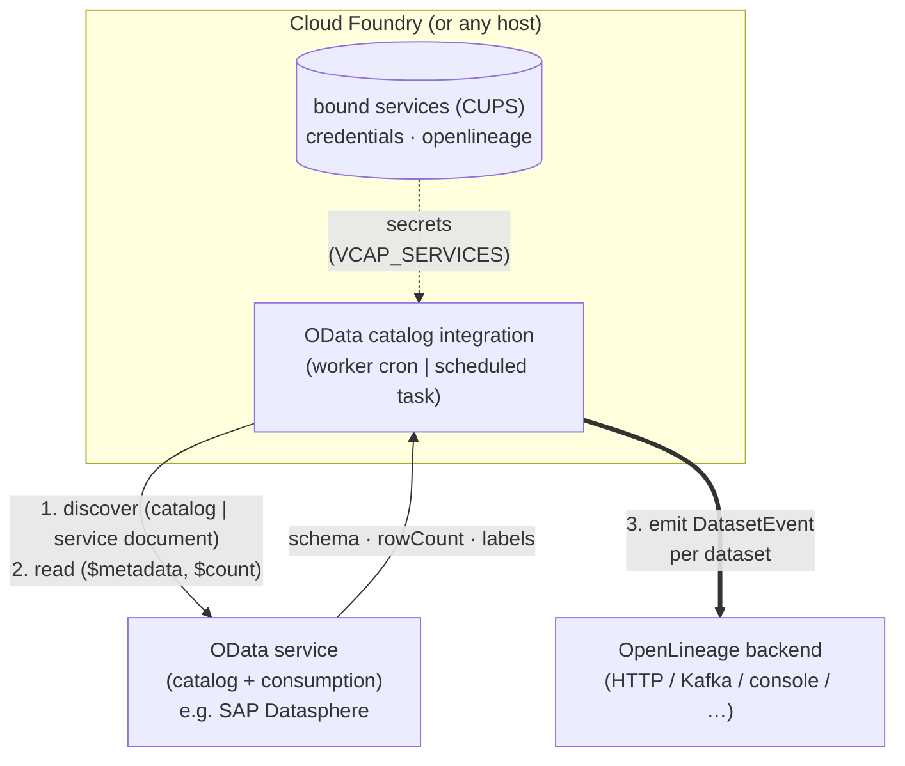

# OpenLineage Integration for OData Catalogs

Scans OData v4 services on a schedule and emits one OpenLineage `DatasetEvent` per dataset,
carrying its schema, row count and last-updated time. Events go to any OpenLineage transport
(HTTP, Kafka, console, …).

It works with any OData v4 service through the standard service document, and with **SAP
Datasphere** through its documented catalog API. Datasphere is the worked example below and the
system it has been run against: an **SAP Business Data Cloud (BDC) Datasphere** tenant.

> **Status: experimental.** Configuration, emitted facets and behaviour may change without notice.
> The integration is **read-only**: it issues OData `GET` requests and never writes to the source
> system, so it cannot disrupt anything running there.
>
> Because it was built against Datasphere first, the config section (`datasphere:`), the secret keys
> (`DATASPHERE_*`) and the `app/datasphere` package still carry that name in both discovery modes.

> This is an independent, community-maintained project, not affiliated with, sponsored by or
> endorsed by SAP SE. SAP and SAP Datasphere are trademarks or registered trademarks of SAP SE or
> its affiliates in Germany and other countries. You bring your own tenant, licence and credentials;
> none are included with this project.

## What it does, and what it does not

It emits **dataset metadata**: schema, row count, last-updated time, business names and where
each dataset can be read. It does **not** emit lineage (jobs, runs, inputs/outputs). OData describes
entity sets, not how they were built, and neither the Datasphere catalog nor the consumption API
exposes view-to-source dependencies. See [Future work](#future-work) for a route to lineage.

## How it finds datasets

Reading a dataset is always standard OData v4: EDMX from `$metadata`, the row count from
`<EntitySet>?$top=0&$count=true`, `$orderby=<col> desc&$top=1`, and `@odata.nextLink` paging. Only
**discovery**, deciding which entity sets to read, has two modes, set by `datasphere.discovery.type`:

| Mode | How datasets are found | Grouping (space) | Namespace |
|---|---|---|---|
| `catalog` (default) | SAP Datasphere catalog service: `catalog/spaces`, then `spaces('<id>')/assets` | Datasphere space | `sap:datasphere://<host>` |
| `services` | the standard OData v4 **service document** of each configured service root; every entity set becomes a dataset | the `name` you give each service | `odata://<host>` |

### Any OData v4 service

`services` mode works with any OData v4 service reachable under `base_url`: no catalog needed,
just the service root paths:

```yaml
datasphere:
  base_url: "https://my-host.example"
  tenant_host: "my-host.example"
  auth:
    type: basic                                   # or bearer / oauth2_client_credentials
  discovery:
    type: services
    services:
      - {name: SALES, path: /odata/v4/sales}      # -> SALES.<EntitySet> for each entity set
```

`$metadata` is fetched once per service and shared by all its entity sets. Each entity set is
mapped to its entity type through the `EntityContainer`, as the spec defines, so set and type
names may differ. The row count uses the `$count=true` query option rather than the `/$count`
path segment, because some servers (Datasphere among them) reject the latter.

### The SAP Datasphere catalog

`catalog` mode uses two documented SAP APIs, both under `/api/v1/datasphere/consumption` (the
default `odata_base_path`):

- [**DatasphereCatalog**](https://api.sap.com/api/DatasphereCatalog/overview): `catalog/spaces` and
  `catalog/assets`, the spaces and assets exposed for consumption.
- [**DatasphereConsumption**](https://api.sap.com/package/sapdatasphere/odatav4): the
  `relational/<SPACE>/<ASSET>/` and `analytical/<SPACE>/<ASSET>/` services each asset points to,
  which serve `$metadata` and the data.

Only assets **exposed for consumption** appear (views with *Expose for Consumption* switched on;
analytic models are exposed automatically), and only in spaces the authenticated user is a member of.

The catalog is itself an OData v4 service (entity sets `spaces` and `assets`, linked by navigation
properties). Checked against an SAP BDC Datasphere tenant:

| Feature | Result | Used |
|---|---|---|
| Service document, `$metadata` | standard | — |
| `$filter=name eq 'A' or name eq 'B'` | works | yes: `spaces.include` is sent to the server |
| `$filter=name in ('A','B')` (OData 4.01) | **silently ignored**, returns every space | no |
| `$select`, `$orderby`, `$skip`, `$count=true` | work | — |
| `$expand=assets` | works, but `$top` is also applied to the expanded assets (non-standard); nested options such as `assets($top=1)` are rejected | no |
| top-level `assets` entity set (with `spaceName`) | works | no; per-space listing keeps one failing space from hiding the rest |
| `<EntitySet>/$count` on a consumption service | **HTTP 400** | no; `?$top=0&$count=true` is used instead |

Three more quirks shape the client:

- The catalog rejects form-style `+` for spaces in query options (`$filter=name+eq+…` is HTTP 400),
  so the client always encodes spaces as `%20`.
- A missing or expired credential is answered with the tenant's **login page and HTTP 200**, not
  a 401. The client treats any `text/html` response as an authentication failure, and does not
  follow redirects.
- Each asset's relational URL is an ordinary OData service root whose service document lists
  exactly one entity set, so `services` mode can also point at individual Datasphere assets.

## What it emits

One `DatasetEvent` per dataset in each enabled space. Standard OpenLineage facets are used wherever
one exists; the only custom facet is `odataError`.

- **namespace**: `sap:datasphere://<tenant-host>` (`catalog` mode) or `odata://<tenant-host>` (`services` mode)
- **name**: `<space>.<asset>`, the stable technical identifier
- **facets**
  - **`schema`**: columns (name, EDM type, business label as `description`) from `$metadata`.
  - **`dataQualityMetrics`**: `rowCount` from `$count=true`, and `lastUpdated` (see
    [lastUpdated](#lastupdated--when-was-data-last-written)) with a `lastUpdatedSource` note.
  - **`documentation`**: the asset's business name.
  - **`catalog`**: `framework: sap-datasphere` (or `odata` in `services` mode), `type: odata`, the technical name, the space, the
    metadata/data URLs (`metadataUri` / `warehouseUri`), and the remaining catalog attributes
    (`businessName`, `space`, `spaceLabel`, `entitySet`, `accessModel`,
    `supportsAnalyticalQueries`, `hasParameters`, analytical URLs) in `catalogProperties`.
  - **`dataSource`**: the tenant host and base URL.
  - **`symlinks`**: the OData data URL(s) where the dataset can actually be read, split into
    `namespace` (`scheme://host`) and `name` (path). The event `name` stays the stable logical id.
  - **`odataError`** *(custom, only on failure)*: `operation`, `httpStatus`, `message`, `url`,
    `correlationId` for each OData call that failed. A dataset whose count or schema request fails
    still produces an event saying what went wrong instead of being dropped.

## Architecture



```
worker.py / run_task.py         entrypoints (daemon with cron | one-shot task)
        │
   tasks/odata_to_ol.py         orchestration (idempotent; errors captured per dataset)
        │
   ┌────┴──────────────────┬──────────────────────┐
 OdataClient             LastUpdatedResolver     LineageEmitter
 (OData v4 reads,        (monitoring |           (standard OpenLineage
  pluggable auth)         max_timestamp_column |  transport)
      │                   design_time)
 Discovery
 (catalog | services)
```

Each of these can be replaced without touching the orchestration: auth (`app/auth`), discovery
(`app/datasphere/discovery.py`), OData client (`app/datasphere`), lastUpdated strategy (`app/lastupdated`), secrets (`app/secrets`) and transport
(OpenLineage config).

## Authentication

Set `datasphere.auth.type`; the matching secrets come from `.env` or bound services (see
`config/.env.example`):

| `auth.type` | Secrets | Use |
|---|---|---|
| `oauth2_client_credentials` (default) | `DATASPHERE_TOKEN_URL`, `_CLIENT_ID`, `_CLIENT_SECRET` | scheduled jobs; a technical OAuth client |
| `oauth2_refresh_token` | the three above + `DATASPHERE_REFRESH_TOKEN` | OAuth authorization-code flow, acting as a named user |
| `basic` | `DATASPHERE_USERNAME`, `_PASSWORD` | generic OData servers |
| `bearer` | `DATASPHERE_TOKEN` | a token obtained elsewhere |
| `cookie` | `DATASPHERE_COOKIE` | **dev/demo only**: a browser session cookie; it expires within hours |

Both OAuth modes cache the access token, refresh it 60 s before it expires and retry once on a 401.
A refresh token rotated by the server is used for the rest of the process, and a warning says the
stored one is stale. Tokens and response bodies never appear in logs or error messages.

Credentials are only ever sent over `https://`. `base_url`, the OAuth token URL and every request
URL (including `@odata.nextLink` values returned by the server) are checked, and anything else is
refused.

> **The API key on api.sap.com is not a tenant credential.** *Show API Key* on the SAP Business
> Accelerator Hub gives a personal key for the Hub's **sandbox** (`sandbox.api.sap.com`, `APIKey`
> header). Datasphere tenants do not accept it, and DatasphereCatalog has no sandbox. Tenants
> authenticate with OAuth (or a browser session).

## Worked example: SAP Datasphere

### 1. Create an OAuth client

A DW Administrator opens **System → Administration → App Integration** and adds an OAuth client:

- **Purpose "API Access"** (technical user) for `oauth2_client_credentials`, or
- **Purpose "Interactive Usage"**, with redirect URI `http://localhost:8080/callback`, for
  `oauth2_refresh_token`. The client acts as the user who logs in.

Note the **Token URL** shown on the same page, typically
`https://<subdomain>.authentication.<region>.hana.ondemand.com/oauth/token`, plus the client ID and
secret.

### 2. Expose the data

The datasets must be exposed for consumption (see [above](#the-sap-datasphere-catalog)), and the
technical user, or the user logging in, must be a member of the spaces to scan.

### 3. Configure

```bash
cd integration/odata
uv sync --extra dev

cp config/config.example.yaml config/config.yaml   # set base_url, tenant_host, spaces.include
cp config/.env.example .env                        # set the OAuth secrets
```

```yaml
datasphere:
  base_url: "https://<tenant>.<region>.hcs.cloud.sap"
  tenant_host: "<tenant>.<region>.hcs.cloud.sap"
  auth:
    type: oauth2_client_credentials     # or oauth2_refresh_token
spaces:
  include: ["SAP_S4H"]
```

For `oauth2_refresh_token`, get the refresh token once. The helper prints a login URL, waits for the
redirect on localhost, and prints the token to put in `.env` as `DATASPHERE_REFRESH_TOKEN`:

```bash
uv run python -m app.oauth_login
```

### 4. Run

```bash
# One-shot scan; the default console transport prints the events:
uv run python -m app.run_task odata_to_ol

# Or run as a daemon on the cron schedule in config.yaml:
uv run python -m app.worker
```

Without `uv`: `python -m venv .venv && . .venv/bin/activate && pip install -r requirements-dev.txt`,
then the same `python -m …` commands.

Against the BDC trial tenant, `spaces.include: [SAP_S4H]` yields one event per exposed view, e.g.
`SAP_S4H.SAP.TIME.VIEW_DIMENSION_QUARTER` with 3 columns and `rowCount` 604. Once the events look
right, switch to an `http` transport (see [Choosing a transport](#choosing-a-transport)).

### 5. Deploy to Cloud Foundry

See [Cloud Foundry](#cloud-foundry): store the OAuth secrets in a `datasphere-oauth` user-provided
service and run the scan as a scheduled task.

## Configuration

Non-secret settings live in `config/config.yaml` (start from `config/config.example.yaml`). Secrets
come from `.env` locally or from bound services on Cloud Foundry; they are never read from the YAML.

Any setting can be overridden with an environment variable named `DS_OL__<section>__<key>` (double
underscores for nesting), e.g. `DS_OL__SCHEDULER__CRON="*/15 * * * *"`. Unknown keys, in the YAML
or in an override, are rejected at startup, so a typo fails instead of being silently ignored.

- **`datasphere.odata_base_path`**: the OData root; the catalog is read from `<odata_base_path>/catalog`.
- **`spaces`**: `include` / `exclude` lists select which spaces are scanned.
- **`lastupdated.strategies`**: tried in order; the first that yields a value wins.
- **`openlineage.transport`**: any standard OpenLineage transport config.

### lastUpdated — when was data last written?

| Strategy | Source | Notes |
|---|---|---|
| `monitoring` | admin monitoring API | the real data-write time; needs the DW Administrator role (403 otherwise). Scaffold only. |
| `max_timestamp_column` | latest value of a timestamp column via `$orderby … desc&$top=1` | works today. The column is picked from the schema using `timestamp_column_patterns`. It reports the newest *value*, which only means "last written" for change timestamps. On a calendar dimension it returns the end of the calendar (e.g. 2050-12-31), so keep the patterns specific. |
| `design_time` | view deployment / modification date | fallback; describes when the definition changed, not the data. The catalog API does not return these dates, so it yields nothing in `catalog` mode today. |

`lastUpdatedSource` on the facet records which strategy and column produced the value. Datasets
without a matching change-timestamp column, such as master-data and calendar views, get no
`lastUpdated`.

### Choosing a transport

`console` is the default and safe for local runs. An `http` transport looks like this:

```yaml
openlineage:
  transport:
    type: "http"
    url: "https://<your-openlineage-endpoint>"
    auth:
      type: "api_key"
      api_key: "${OPENLINEAGE_API_KEY}"   # resolved from .env / bound services
    compression: "gzip"
```

`${VAR}` placeholders are resolved from the secrets provider. An unresolved placeholder is a
startup error, never an empty string. Any OpenLineage-compatible backend works; see the
[transport docs](https://openlineage.io/docs/client/python/#transports) for the full list.

## Cloud Foundry

Two deployment shapes are provided (`manifest.yml`, `manifest-task.yml`):

- **Worker** with the built-in cron: a route-less app with `health-check-type: process` and one
  instance, running `python -m app.worker`. Deploy with `cf push`.
- **Scheduled task** (recommended): `cf push -f manifest-task.yml --task` (stages the app without
  starting it), then have SAP Job Scheduling Service start `python -m app.run_task odata_to_ol` on a cron. The task reuses the app's
  droplet, environment and bindings.

Credentials come from user-provided services, read through `app/secrets.py`. The key names are the
same locally (`.env`) and on CF (`VCAP_SERVICES`):

```bash
cf cups datasphere-oauth -p '{"DATASPHERE_TOKEN_URL":"...","DATASPHERE_CLIENT_ID":"...","DATASPHERE_CLIENT_SECRET":"..."}'
cf cups openlineage      -p '{"OPENLINEAGE_API_KEY":"..."}'
```

For `oauth2_refresh_token`, add `DATASPHERE_REFRESH_TOKEN` to `datasphere-oauth`.

Logs go to stdout as JSON and containers run in UTC. SIGTERM allows about 10 s to shut down. Every
run is idempotent, so emitting the same snapshot twice is harmless.

## Development

```bash
cd integration/odata
uv sync --extra dev
uv run pytest            # unit tests, no network access
uv run ruff check . && uv run ruff format --check .
```

In the monorepo, `openlineage-python` is resolved from `client/python` through
`[tool.uv.sources]`, so client changes are tested against this integration in CI.
`requirements.txt` keeps the published PyPI pin, which is what the Cloud Foundry buildpack installs.

## Future work

- **Lineage from Datasphere design-time definitions.** The Datasphere command-line interface's
  API (`/dwaas-core/api/v1/spaces/<space>/views/<name>`, described by
  `/dwaas-core/api/v1/discovery`) returns each view's CSN definition, whose `from` and column
  references give table- and column-level lineage. It would be a separate extractor emitting job
  events.
- **SAP Business Data Cloud data products.** On BDC, a view's CSN names the data product it reads
  (`<source system>.<product>:<version>.<entity>`, e.g. `HANACurrency:v1.TCURR`) and the source
  system's tenant id. Together with the lineage above, these could be emitted as the views' source
  datasets, e.g. under `sap:bdc://<source system tenant id>`.
- **Verify OAuth end to end** against a tenant with an OAuth client, and record which grant(s) the
  consumption API accepts. The OAuth code is unit-tested; the live runs so far used `cookie`.
- **Verify `services` mode on a non-SAP OData v4 service.** So far it has only been run against
  Datasphere asset service roots.
- **More discovery sources.** Other catalogs (e.g. SAP Gateway's catalog service) can be added as
  further `discovery.type` values; each only has to produce service roots and entity sets.
- **Neutral naming.** Rename the Datasphere-specific config section, secret keys and package. The
  `catalog`-mode namespace needs a separate decision, since changing it changes dataset identity.
- **Real data-write `lastUpdated`** via the admin monitoring API (the `monitoring` strategy is
  scaffolded).
- **Tags.** Datasphere tags are not in the OData catalog. Once wired, emit them with the standard
  `tags` facet and allow filtering by tag alongside `spaces.include` / `exclude`.

----
SPDX-License-Identifier: Apache-2.0\
Copyright 2018-2026 contributors to the OpenLineage project
