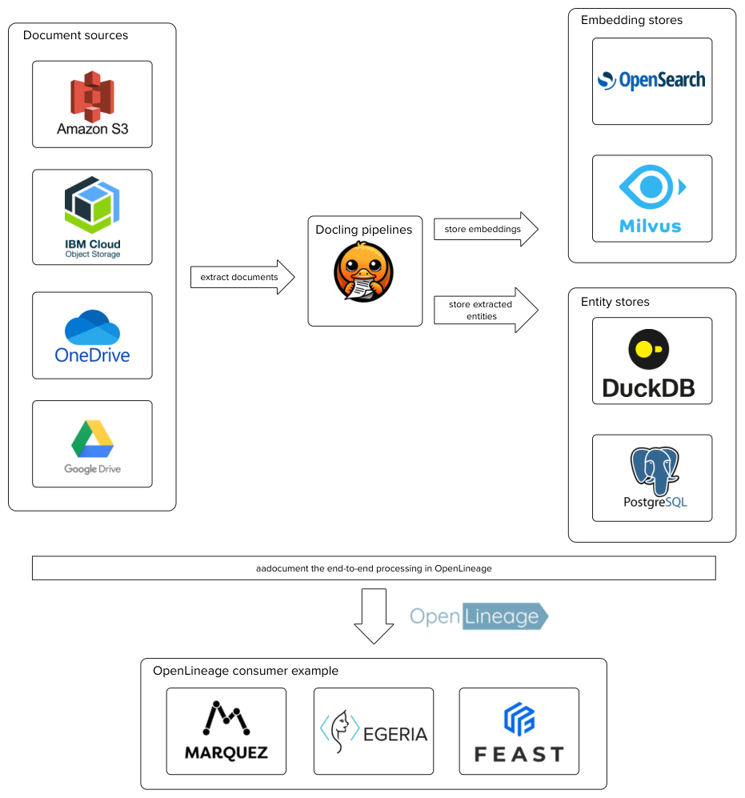

Retrieval Augmented Generation (RAG) applications are only as trustworthy as the documents behind them. When an AI assistant gives a surprising answer, the first question is usually "where did that come from?" Answering it means tracing a chunk in a vector index back through embedding, chunking, and extraction to the original file in a SharePoint folder or S3 bucket. [Docling pipelines](https://github.com/docling-project/docling-pipelines) is becoming an OpenLineage producer, so that this trail can be captured automatically.

<!--truncate-->

## What is Docling pipelines?

Docling pipelines is an open-source document curation pipeline for RAG applications. It ingests data from unstructured sources, curates the documents, and writes entities and vector embeddings to targets, which makes the content AI-ready at scale.

It connects to a wide range of document sources, including local filesystems, Amazon S3, IBM COS, SharePoint, OneDrive, Google Drive, Box, Dropbox, and web pages. It then uses [Docling](https://github.com/docling-project/docling) to extract content and entities from PDF, DOCX, HTML, images, and other formats. The extracted content is curated for LLMs, converted into chunks and embeddings, and stored in a vector database such as Milvus or OpenSearch.

Pipelines are defined as JSON flows: a DAG of operators that covers the typical stages of document curation.

| Stage | Examples of operators |
| --- | --- |
| Ingest | Local and remote source ingest |
| Extract | Document extraction, ACL extraction |
| Functional | Chunking, embeddings, branching, merge, entity curation |
| Quality | Language detection, readability, PII/HAP detection, deduplication, redaction, SQL filtering, classification |
| Output | Vector databases (OpenSearch, Milvus, Weaviate), document sets, and storage targets such as filesystem or S3 |

Flows can be run from the CLI, the Python API, or a REST API.

## Why lineage matters for document pipelines

Document curation pipelines look simple on a diagram, but they are full of decisions that change what ends up in a vector index. Lineage helps answer questions that are otherwise hard to answer after the fact:

* **Provenance.** Which source system, bucket, or folder did the content in this index come from? When a document is corrected or withdrawn at the source, which pipeline runs and downstream indexes are affected?
* **Auditability.** Regulated and enterprise environments need a record of what was processed, by which pipeline, and where the result was written. This is especially relevant when the pipeline performs PII detection or redaction.
* **Debugging data quality.** If an index suddenly holds fewer chunks than expected, you need to know which step dropped the documents: a filter, a deduplication step, or an extraction failure.
* **Impact analysis.** Several flows may write into the same vector database or document set. Lineage shows which flows feed it and which consumers depend on it.
* **Operations.** Run status, failures, and per-run document counts are the basis for dashboards and alerting on ingestion health.

Because these pipelines often feed multiple teams and tools, a vendor-neutral standard matters. By emitting OpenLineage events, Docling pipelines can be observed by any OpenLineage-compatible backend, such as [Marquez](https://marquezproject.ai), without a custom integration for each one.

## What lineage can Docling pipelines emit?

The integration is opt-in: nothing is emitted unless lineage is explicitly enabled. When it is, it can emit lineage at two levels of granularity, so you can choose between a high-level view and a detailed one.

**Flow level** is the default. Each pipeline run is reported as a single OpenLineage job named after the flow. You see where the documents came from, where the results were written, whether the run succeeded, and how many documents were processed, failed, or skipped. It produces few events, which makes it a good fit for production monitoring and dashboards.

**Operator level** adds a job for every step in the pipeline, such as extraction, chunking, or deduplication. These jobs are nested inside the flow run, and each reports its own inputs, outputs, metrics, and errors. This is the mode to use when you need to find out which step changed document counts or introduced a data quality problem. The trade-off is a higher event volume.

In both modes, lineage is aggregated per run rather than recorded for each individual file, so you get document and row counts, not a separate lineage record per document.

### Going deeper: lineage for individual files

The question "which exact file ended up in this answer?" is a natural one for a RAG pipeline, and the current model cannot fully answer it. The reason is scale. In OpenLineage, a dataset is an entry in the `inputs` or `outputs` of an event, and the event is a single JSON document. A document pipeline can process anywhere from thousands to millions of files in one run. Listing each of them as a separate dataset would produce events that are too large to emit, store, or process.

Docling pipelines therefore represents a source as a single dataset, such as a folder or a bucket prefix, and reports per-run counts. This keeps events small, but lineage stops at the collection of files and does not reach the individual file. The same trade-off applies to any producer that handles a very large number of files and might need a different mechanism in the OpenLineage specification going forward.

## Learn more

* [Docling pipelines on GitHub](https://github.com/docling-project/docling-pipelines)
* [Docling pipelines OpenLineage guide](https://github.com/docling-project/docling-pipelines/blob/main/docs/integrations/openlineage/OPENLINEAGE_GUIDE.md), covering configuration, dataset naming, and custom facets
* [Know Where Every Document Went](https://medium.com/@msoni6226/know-where-every-document-went-openlineage-support-in-docling-pipelines-d12c04d2c183), a technical walkthrough by the integration's author